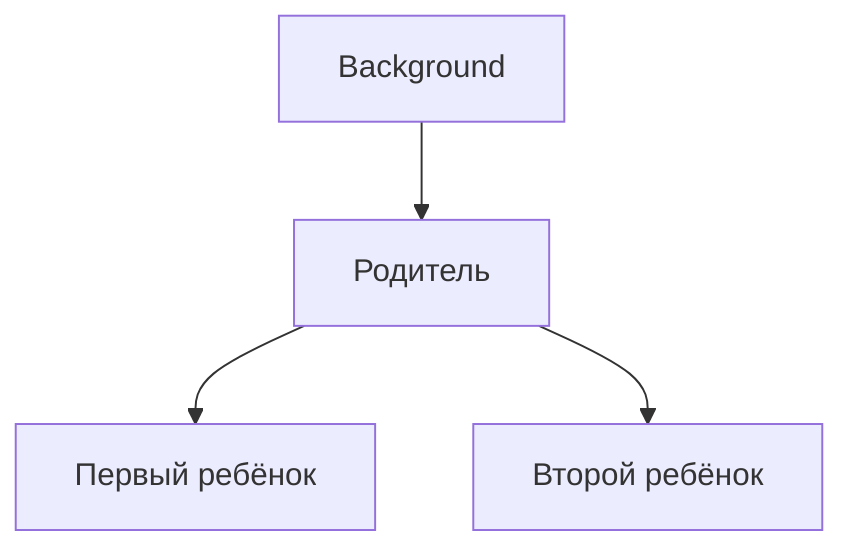

# Основы context.Context

## Цель

Разобраться, как передавать отмену через цепочку вызовов, строить дерево контекстов, отличать причину отмены от стандартного статуса и передавать небольшой идентификатор запроса.

Здесь собраны механизмы, которые раньше использовались по отдельности в конвейере, пуле и сборе результатов. [Сбор результатов](../../03-concurrency-patterns/06-collecting-results/README.md)

## Запуск

Из корня репозитория:

```bash
go run ./04-coordination-and-cancellation/01-context-basics
go test -v -timeout 10s ./04-coordination-and-cancellation/01-context-basics
go test -race -timeout 10s ./04-coordination-and-cancellation/01-context-basics
```

Перед первым запуском предскажи, что будет с родителем и соседним контекстом после отмены одного ребёнка.

## 1. Что передаёт контекст

| Метод | Что даёт вызываемому коду |
|---|---|
| `Done()` | Канал, который закрывается при отмене или истечении срока |
| `Err()` | `nil`, пока контекст активен, затем `context.Canceled` или `context.DeadlineExceeded` |
| `Deadline()` | Абсолютный срок и признак его наличия |
| `Value(key)` | Значение, связанное с запросом, или `nil` |

`context.Background()` подходит как корень в `main` и тестах. У него нет срока и `Done() == nil`, поэтому ветка чтения из `Done` в `select` отключена. `context.TODO()` выражает намерение выбрать подходящий родительский контекст позже.

В функции контекст обычно передают первым параметром, явно по цепочке вызовов. Если функция получила `ctx` от вызывающего кода, дочернюю работу следует выводить из него. Создание нового `Background()` оторвёт её от уже существующего срока и отмены.

## 2. Дерево и направление отмены



`context.WithCancel(parent)` возвращает дочерний контекст и функцию отмены. В первом примере вызов `cancelFirst()` отменяет только первого ребёнка и его потомков. Родитель и второй ребёнок остаются активными. Затем `cancelParent()` отменяет родителя и активные дочерние контексты.

Создающий дочерний контекст обычно владеет его `cancel` и вызывает `defer cancel()` рядом с созданием. Это освобождает связанные ресурсы, даже если функция завершилась раньше обычного. Вызов отмены повторно допустим. Уже отменённый контекст нельзя вернуть к активному состоянию.

Отмена закрывает `Done`, но ожидание выхода работающих горутин остаётся отдельным шагом. Для него подходят канал завершения или `WaitGroup`.

## 3. Ожидание события

`waitForSignal` сначала проверяет `ctx.Err()`, затем ждёт событие или отмену:

```go
select {
case <-signal:
    return nil
case <-ctx.Done():
    return ctx.Err()
}
```

Если контекст уже отменён при входе, предварительная проверка возвращает ошибку даже при готовом событии. Если оба события станут готовы после проверки, `select` может выбрать любое. Такое поведение должно быть частью контракта, особенно если после успеха вызывающий код выполняет необратимое действие.

Нулевой канал события отключает ветку. Это полезно в тесте на ожидание исключительно отмены. Если и событие, и `Done` равны `nil`, ждать придётся бесконечно. В рабочем коде хотя бы у одного события должен быть путь к завершению.

## 4. Статус и причина отмены

`context.WithCancelCause` позволяет передать причину через функцию отмены. В третьем примере родитель отменяется с ошибкой `request withdrawn`. Активный дочерний контекст получает два разных значения:

- `child.Err()` возвращает общий статус `context.Canceled`.
- `context.Cause(child)` возвращает конкретную ошибку родителя.

Первая отмена определяет причину. Если ребёнок уже отменён самостоятельно, последующая отмена родителя не заменит его прежнюю причину. В примере `defer cancel(nil)` служит страховкой для других путей выхода и не перезаписывает уже записанную причину.

Обычно для ветвления по отмене удобно использовать `Err`, а для объяснения причины — `Cause`. Ошибка самой операции всё ещё может возвращаться обычным результатом функции.

## 5. Метаданные запроса

`withRequestID` хранит строку под отдельным типом ключа. Так внутренний ключ не совпадёт с ключом другого пакета, который тоже захотел сохранить ID запроса. Функция `requestID` использует безопасное утверждение типа и возвращает признак присутствия:

```go
id, ok := ctx.Value(requestIDKey{}).(string)
```

Потомки видят значение родителя. Потомок может добавить своё значение под тем же ключом, действующее для него и его потомков. Исходный родитель сохраняет собственное значение. Отмена меняет статус контекста, а метаданные остаются доступными.

В контекст подходят небольшие данные, сопровождающие запрос через границы API, например идентификатор трассировки. Число воркеров, правила обработки и параметры конфигурации проще читать и проверять как явные аргументы. Сам контекст можно передавать нескольким горутинам, но изменяемые объекты внутри `Value` всё равно требуют собственной синхронизации.

## Ожидаемый вывод

```text
=== 1. Parent and child cancellation ===
Child cancelled: parent=<nil> first=context canceled second=<nil>
Parent cancelled: parent=context canceled second=context canceled

=== 2. Wait for an event ===
Event ready: <nil>
Wait cancelled: context canceled

=== 3. Cancellation cause ===
Child status: context canceled; cause: request withdrawn

=== 4. Request metadata ===
Request ID: request-42; present=true
Root has request ID: false
Request ID after cancellation: request-42
```

## Что проверяют тесты

- Готовое событие завершается успешно, а предварительно отменённый контекст возвращает ошибку даже при готовом событии.
- После отмены родителя заблокированное ожидание ребёнка выходит. Тест ждёт блокировку через `testing/synctest` и ограничивает ожидание ответа виртуальным таймером.
- Метаданные наследуются, потомок может их перекрыть, отмена не удаляет значение. Пустая строка с `ok == true` отличается от отсутствующего ключа.

## Попробуй самостоятельно

1. Добавь в дерево внука. Что изменится после вызова `cancelFirst()`?
2. Отмени ребёнка с собственной причиной, затем отмени родителя с другой причиной. Проверь оба контекста через `context.Cause`.
3. Построй функцию, которая ждёт два независимых события подряд и передаёт один контекст в оба ожидания.
4. Добавь идентификатор операции как отдельный тип ключа и покажи, что он сосуществует с ID запроса.
5. Напиши небольшой пример, где создатель контекста отменяет работу и затем дожидается её завершения.

## Следующий шаг

Добавим дедлайн и проверим, как один бюджет расходуется между несколькими чтениями. [Отмена и дедлайны](../02-cancellation-and-deadlines/README.md)

## Самопроверка

Сначала ответь самостоятельно. Затем раскрой ответ и сравни объяснение со своим.

### 1. Понимание

Как распространяется отмена, если у родителя два потомка?

<details>
<summary>Показать ответ и объяснение</summary>

Отмена родителя распространяется на обоих потомков и дальше вниз. Отмена одного потомка достигает только его ветки. Она не меняет родителя и соседнюю ветку.

</details>

### 2. Вывод кода

Что вернут `child.Err()` и `context.Cause(child)`, если активного родителя отменить через `cancel(errors.New("клиент ушёл"))` из `WithCancelCause`?

<details>
<summary>Показать ответ и объяснение</summary>

`Err()` возвращает `context.Canceled`, а `Cause` возвращает ошибку с текстом `клиент ушёл`. Причина первой отмены сохраняется у потомка.

</details>

### 3. Вывод кода

Что вернёт `requestID(child)` после отмены, если `child` получен через `WithCancel(withRequestID(root, "r-7"))`?

<details>
<summary>Показать ответ и объяснение</summary>

`"r-7", true`. Отмена меняет статус и закрывает `Done()`, а доступ к метаданным сохраняется.

</details>

### 4. Типичная ошибка

Почему `waitForSignal(context.Background(), nil)` не вернётся сам?

<details>
<summary>Показать ответ и объяснение</summary>

Сигнальный канал равен `nil`, а у `Background` метод `Done()` тоже возвращает `nil`. Обе ветки `select` выключены. Нужен источник события или отменяемый контекст.

</details>

### 5. Типичная ошибка

Что теряет вызываемая функция, если подменит полученный `ctx` на `context.Background()`?

<details>
<summary>Показать ответ и объяснение</summary>

Обрывается связь с отменой, дедлайном и значениями запроса. Чтобы добавить локальную отмену с сохранением этой связи, создай дочерний контекст из переданного родителя.

</details>
